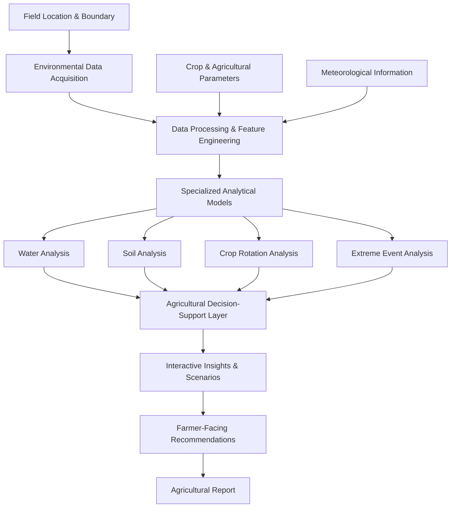

# TerraPulse — From Space to Soil
### Turning Earth Observation into Smarter, More Resilient Agriculture

<p align="center">
  
</p>

<p align="center">
  <strong>NASA Space Apps Challenge 2026</strong><br/>
  <em>Challenge: Field Shift — Adapting Farms with NASA Data</em>
</p>

<p align="center">
  <strong>Authors:</strong> Georgios Gkekas · Thomas Kyritsis
</p>

<p align="center">
  <a href="https://github.com/geogek10/Terra_Pulse_NGM_Team_NASA_Space_Apps_Challenge_2026">GitHub Repository</a> ·
  <a href="https://canva.link/r5jtxxe224ry0d1">Pitch Deck</a> ·
  <a href="https://drive.google.com/file/d/1H2_RAsfx15EeBXayk801OG2dDIiEk_Ui/view?usp=drive_link">Project Demo</a> ·
  <a href="https://drive.google.com/file/d/1Itrr0SEqXuZhnRUyevfTjdnPLwHSKElD/view?usp=drive_link">Scientific Paper</a>
</p>

---

## 1. The Problem: Agriculture Needs Better Decisions

Agriculture is increasingly exposed to interconnected environmental pressures. Changing rainfall patterns, prolonged droughts, soil degradation, extreme temperatures and declining soil fertility make it increasingly difficult for farmers to maintain productive and resilient agricultural systems.

One of the most consequential decisions farmers face is **what to cultivate next**.

Choosing a crop is not simply a matter of identifying what grows well under current weather conditions. Sustainable crop selection requires considering:

- **Soil health:** How will the next crop affect soil fertility, organic matter and nutrient availability?
- **Water availability:** Can the field sustainably support the water requirements of the selected crop?
- **Crop rotation:** How can crop sequences reduce nutrient depletion and support biological nitrogen replenishment?
- **Climate resilience:** How will changing temperatures, rainfall patterns and extreme weather affect future growing seasons?
- **Economic viability:** Can farmers improve environmental sustainability without compromising their livelihoods?

These decisions are interconnected, yet relevant environmental information is often scattered across different datasets, scientific platforms and agricultural tools.

Farmers need more than satellite imagery or isolated environmental measurements. They need a way to translate this information into understandable, evidence-informed agricultural decisions.

## 2. Our Solution: TerraPulse

**TerraPulse is an AI-powered agricultural decision-support platform that connects Earth observation, environmental intelligence and specialized analytical models to help farmers make more informed decisions about their fields.**

Inspired by the precision of space exploration and the resilience of agriculture, TerraPulse translates complex environmental information into practical, field-level insights.

The platform is designed around one central question:

> **How can we cultivate today's land without compromising tomorrow's soil?**

By combining geospatial field analysis, meteorological information, agricultural parameters and machine-learning-based analytical models, TerraPulse helps users explore:

- When and how much to irrigate.
- Where environmental stress may be developing.
- How soil degradation and erosion risks can be reduced.
- Which crop rotations may support soil recovery.
- How alternative crops and agricultural practices could affect environmental and economic outcomes.
- How fields may respond to extreme weather scenarios.

Rather than overwhelming farmers with raw scientific data, TerraPulse organizes its outputs into understandable recommendations, interactive visualizations and downloadable agricultural reports.

**Our objective is to bridge the gap between observations from space and decisions made on the ground.**

## 3. Alignment with the NASA Space Apps Challenge

TerraPulse was developed for the 2026 NASA Space Apps Challenge, specifically the challenge:

**Field Shift: Adapting Farms with NASA Data.**

The challenge calls for a decision-support tool that combines NASA Earth observations with local soil information, crop characteristics and farmer priorities to help explore crop rotations that strengthen soil health and improve agricultural resilience.

TerraPulse addresses this problem through four interconnected analytical domains:

| Challenge requirement | TerraPulse approach |
|---|---|
| Environmental observations | Geospatial and meteorological data analysis |
| Soil health | Soil degradation and erosion indicators |
| Crop rotation | Crop suitability, nitrogen fixation and rotation comparisons |
| Water conservation | Soil moisture analysis and irrigation scheduling |
| Farmer priorities | Crop and irrigation scenario simulator |
| Decision support | Explainable outputs, visualizations and agricultural reports |

**Our central focus is sustainable crop selection and agricultural resilience.** The additional water, soil and extreme-event modules provide environmental context that can support these decisions.

---

## 4. How TerraPulse Works

TerraPulse follows a multi-stage analytical workflow, transforming field information into agricultural insights.



### Step 1 — Define the field

Users can search for a geographical location or draw their own field boundary using the interactive map.

TerraPulse calculates the field's geographical area and creates a location-specific analytical profile.

### Step 2 — Collect environmental information

The backend retrieves available meteorological, soil-moisture and elevation information through its configured data providers.

NASA Earth observation products and scientific datasets are also referenced in the project's research and model-parameterization approach.

### Step 3 — Analyze environmental conditions

The backend prepares environmental features and passes them to the corresponding analytical models.

### Step 4 — Explore agricultural scenarios

Users can modify crop selections, irrigation methods and environmental scenarios to investigate how different assumptions affect the analytical outputs.

### Step 5 — Translate results into decisions

TerraPulse presents the results through interactive maps, visual indicators, charts, plain-language explanations and downloadable reports.

---

## 5. NASA Earth Observation & Data Integration

Earth observation provides an essential scientific foundation for understanding agricultural environments at different spatial and temporal scales.

TerraPulse's research and model-parameterization framework references several NASA Earth science missions and datasets.

### NASA datasets referenced in the scientific framework

| NASA mission / dataset | Environmental relevance | Potential agricultural application |
|---|---|---|
| NASA POWER | Solar and meteorological parameters | Climate and crop-water analysis |
| SMAP | Surface and root-zone soil moisture products | Water availability and drought analysis |
| ECOSTRESS | Land-surface temperature and evapotranspiration | Thermal and water-stress assessment |
| GPM | Global precipitation observations | Rainfall variability and water assessment |
| Landsat | Multispectral land observations | Vegetation and land-condition analysis |
| MODIS | Vegetation and land-surface products | Vegetation monitoring and environmental trends |
| SRTM | Digital elevation information | Terrain and slope analysis |

### How these datasets contribute

**Soil moisture and drought**

Soil-moisture observations provide information about the availability of water in the terrestrial environment. These indicators can support drought assessment and agricultural water-management analysis.

**Vegetation condition**

Spectral vegetation indicators can help characterize vegetation condition and monitor changes over time. They provide useful environmental context but should not be interpreted as direct measurements of soil fertility.

**Thermal stress**

Land-surface temperature and evapotranspiration products can contribute to understanding environmental heat stress and crop-water interactions.

**Precipitation variability**

Satellite precipitation products help characterize rainfall patterns and support the assessment of water availability.

**Terrain analysis**

Elevation and slope information contribute to identifying terrain-related erosion risks and spatial differences across agricultural fields.

### Data provenance and implementation status

Transparency about data origins is essential for scientific credibility.

The current documented live application pipeline uses:

- Open-Meteo for historical meteorological information, forecasts, soil-moisture estimates and evapotranspiration-related parameters.
- Open-Meteo Elevation API for elevation sampling.
- OpenStreetMap Nominatim for geographical search.
- Esri World Imagery and OpenTopoMap for map visualization.

NASA POWER, SMAP, ECOSTRESS, GPM, Landsat, MODIS and SRTM are referenced in the scientific framework and model parameterization.

**Important distinction:** Listing a NASA dataset as a scientific reference does not imply that the application currently retrieves and processes its raw observations through a live NASA API. Direct NASA product integration, where not yet implemented, is a development objective rather than a claimed operational capability.

TerraPulse is designed to make the provenance, temporal coverage, spatial resolution and limitations of its environmental inputs explicit as the data pipeline develops.

---

## 6. Intelligent Crop Rotation & Soil Recovery

**Crop rotation is the central agricultural decision-making domain of TerraPulse.**

Repeated cultivation of the same crop can contribute to nutrient depletion, changes in soil structure and increased vulnerability to certain pests and diseases.

Strategic crop rotation can help address these challenges by introducing crops with different nutrient requirements, rooting characteristics and environmental demands.

One particularly important mechanism is biological nitrogen fixation (BNF).

### The role of nitrogen-fixing crops

Leguminous crops can form symbiotic relationships with nitrogen-fixing bacteria, converting atmospheric nitrogen into biologically available forms.

Depending on the crop, soil conditions, climate and management practices, this process can contribute to the nitrogen balance of agricultural systems.

TerraPulse's rotation model explores:

- Crop suitability under different environmental conditions.
- Aridity and soil-moisture conditions.
- Soil organic matter indicators.
- Terrain characteristics.
- Potential nitrogen contributions from legumes.
- Three-year nitrogen-recovery scenarios.
- Comparative economic outcomes.

### The rotation analysis workflow

1. **Assess the environment:** Analyze available moisture, aridity, terrain and soil-related indicators.
2. **Evaluate candidate crops:** Compare potential rotation crops, including legumes, alfalfa, wheat and sorghum.
3. **Estimate nitrogen contributions:** Explore potential biological nitrogen fixation under the model's assumptions.
4. **Compare scenarios:** Examine projected nitrogen balances and economic differences.
5. **Support decisions:** Present comparative outputs to help farmers explore alternative cultivation strategies.

### Important scientific considerations

Biological nitrogen fixation is not equivalent to the total nitrogen content of a crop or the amount of nitrogen automatically available to the following crop.

Actual nitrogen benefits depend on biomass production, crop removal, residue management, soil conditions, bacterial activity and other agronomic factors.

Similarly, reliable crop-rotation recommendations require information about previous crops, local crop calendars, soil constraints, disease cycles and farmer priorities.

These factors must be incorporated and locally validated before the platform's outputs can be treated as complete agronomic prescriptions.

---

## 7. The Four Specialized PyTorch Analytical Models

TerraPulse uses four specialized PyTorch neural networks to analyze interconnected agricultural and environmental conditions.

Because comprehensive, multi-year, field-level labeled datasets spanning all four analytical domains are scarce, the project adopts a **biophysically informed surrogate-modeling approach**.

The models are parameterized using agro-climatic information, NASA Earth observation-informed priors and established scientific frameworks, including FAO-56, RUSLE, biological nitrogen fixation principles and post-fire dNBR-based assessment.

These models are intended to support environmental analysis and scenario exploration. Their outputs should be interpreted according to the underlying data, model assumptions and validation status.

### Network 1 — Water Intelligence

<details>
<summary><strong>Water: Drought & Irrigation Analysis</strong></summary>

**Objective:** Analyze agricultural water conditions and support more efficient irrigation decisions.

**Documented inputs:**
- Historical temperature.
- Precipitation.
- Soil moisture.
- NDVI.
- Terrain slope.
- Reference evapotranspiration (ET₀).

**Documented outputs:**
- Root-zone water-stress proxy (0–1).
- Estimated irrigation requirements (m³/stremma).
- Suggested irrigation time windows.
- Rainfall-aware irrigation scheduling.

**Farmer value:**

The model helps users explore irrigation requirements under different environmental conditions and avoid unnecessary watering when sufficient rainfall is forecast.

</details>

### Network 2 — Soil Intelligence

<details>
<summary><strong>Soil: Degradation & Depletion Analysis</strong></summary>

**Objective:** Examine environmental indicators associated with soil condition and erosion vulnerability.

**Documented inputs:**
- Spectral vegetation information.
- Organic matter parameters.
- Terrain slope.
- Precipitation.
- Aridity.

**Documented outputs:**
- Soil-health proxy (0–1).
- Erosion-risk proxy (0–1).
- Nitrogen, phosphorus and potassium balance indicators.
- Carbon-related indicators.
- Soil-management suggestions, including cover crops and reduced tillage.

**Farmer value:**

The model helps identify potential soil-management priorities and explore practices that may contribute to long-term soil conservation.

**Scientific qualification:** A modeled soil-health proxy is not a laboratory measurement of soil organic matter, pH or nutrient concentration.

</details>

### Network 3 — Crop Rotation Intelligence

<details>
<summary><strong>Crop Rotation: Crop Matchmaking & Nitrogen Recovery</strong></summary>

**Objective:** Compare potential rotation crops under different environmental and agricultural conditions.

**Documented inputs:**
- Aridity.
- Soil organic matter.
- Terrain slope.
- Soil moisture.

**Documented outputs:**
- Crop suitability scores.
- Rotation crop comparisons.
- Estimated biological nitrogen fixation (kg N/ha).
- Three-year nitrogen-recovery scenarios.
- Comparative return-on-investment estimates.

**Farmer value:**

The model helps explore alternative cultivation strategies that balance environmental suitability, potential soil benefits and economic considerations.

**Scientific qualification:** Nitrogen and economic projections depend on assumptions and input parameters. They are not measurements of actual field-level nitrogen recovery or guaranteed farm profitability.

</details>

### Network 4 — Extreme Event Intelligence

<details>
<summary><strong>Extreme Events: Wildfire, Erosion & Recovery Analysis</strong></summary>

**Objective:** Examine potential agricultural vulnerability following extreme environmental events.

**Documented inputs:**
- Burn severity indicators (dNBR).
- Terrain slope.
- Vegetation condition.
- Canopy heat indicators.

**Documented outputs:**
- Post-fire erosion-risk proxy.
- Vegetation recovery score.
- Twelve-month vegetation-recovery scenarios.
- Rapid-seeding planning scenarios.
- Farmer alert previews.

**Farmer value:**

The model provides an exploratory framework for understanding potential post-fire agricultural risks and identifying areas that may require closer assessment.

**Scientific qualification:** A simulated recovery trajectory or alert is not a verified prediction of future field conditions.

</details>

### Model overview

| Model | Primary domain | Main analytical purpose |
|---|---|---|
| Network 1 | Water | Drought and irrigation analysis |
| Network 2 | Soil | Degradation and erosion assessment |
| Network 3 | Crop rotation | Crop suitability and nitrogen scenarios |
| Network 4 | Extreme events | Post-fire vulnerability and recovery |

---

## 8. Farmer-Centered Decision Support

TerraPulse is designed to make complex environmental information accessible without sacrificing the scientific detail required for further investigation.

The interface uses a two-layer information architecture.

### Layer 1 — At a Glance

Designed for quick interpretation.

Farmers receive:

- An animated environmental indicator.
- A plain-language assessment.
- A concise explanation of the current conditions.
- A numbered action plan.
- Important environmental warnings.

### Layer 2 — Scientific Analytics

Designed for more detailed investigation.

Users can explore:

- Multi-series environmental charts.
- Regional comparisons.
- Irrigation schedules.
- Economic cost breakdowns.
- Interactive geographical visualizations.
- Detailed model outputs.
- Scientific summaries.

This separation allows farmers to access understandable information while retaining the ability to inspect the underlying analytical results.

---

## 9. Key Platform Features

### Interactive 3D Earth Landing Page

A Three.js-powered introduction featuring a three-dimensional Earth, orbital rings and an animated satellite marker.

Includes:
- Dark and light themes.
- Greek and English language support.
- Animated visual elements.

### Interactive Field Map OS

Built using Leaflet and Leaflet.Draw.

Features:
- Dark, satellite and NDVI/topographic visualization layers.
- Worldwide geographical search.
- Custom field-boundary drawing.
- Automatic geodesic field-area calculation.
- Area display in hectares and Greek stremmata.
- Field A/B comparison.
- 3×3 Variable Rate Application (VRA) demonstration grid.

The VRA grid visualizes nine color-coded sub-zones with illustrative application-rate adjustments.

These adjustments are scenario visualizations and should not be interpreted as calibrated fertilizer prescriptions without field-level validation.

### What-If Farmer Simulator

Users can modify three major parameters:

**Crop selection**
- Durum wheat.
- Cotton.
- Corn.
- Olive grove.
- Vineyard.
- Alfalfa.

**Irrigation method**
- Flood furrow.
- Overhead sprinkler.
- Subsurface drip.

**Environmental scenarios**
- Live forecast.
- Heatwave (+5.5°C).
- Post-fire storm.

The simulator updates its analytical outputs and visualizations to demonstrate how alternative assumptions affect the results.

### Voice Briefing

A built-in Web Speech API feature reads agricultural assessments aloud.

Supported languages:
- Greek (el-GR).
- English (en-US).

### Bilingual Interface

TerraPulse supports Greek and English throughout its interface, charts, voice briefings and reports.

### PDF Agricultural Report

A print-optimized report allows users to export a clean, one-page summary of the selected field analysis.

---

## 10. Environmental & Economic Impact

TerraPulse aims to support agricultural practices that improve resource efficiency, reduce unnecessary inputs and strengthen long-term environmental resilience.

Its impact framework focuses on three main areas.

### Water conservation

More informed irrigation scheduling can help reduce unnecessary water applications and associated pumping costs.

### Soil recovery

Strategic crop diversification, nitrogen-fixing crops, cover crops and soil-conservation practices can contribute to improved agricultural sustainability.

### Economic resilience

Better-informed decisions can help farmers evaluate the relationship between input costs, environmental constraints and potential agricultural returns.

### Literature-benchmarked impact targets

The accompanying scientific paper identifies the following literature-derived benchmarks as potential impact opportunities:

| Indicator | Literature-benchmarked target |
|---|---:|
| Potential water conservation | 27–45% |
| Potential reduction in synthetic nitrogen dependency | Up to 40% |
| Reported biological nitrogen fixation ranges referenced in the paper | 32–115 kg N/ha/year |

**These figures are contextual benchmarks, not measured TerraPulse results or guaranteed outcomes.**

Actual improvements depend on local agricultural conditions, crop selection, irrigation infrastructure, management practices and the quality of the underlying data.

TerraPulse's future impact evaluation should compare its recommendations against conventional agricultural management using clearly defined field-level indicators.

---

## 11. Scientific Methodology, Validation & Limitations

Scientific transparency is fundamental to TerraPulse.

The platform combines environmental information, established scientific principles and neural-network-based analytical models. Its outputs therefore need to be interpreted according to their evidence base.

### Scientific foundations

The project's documented scientific framework references:

- **FAO-56:** Crop evapotranspiration and irrigation-water requirements.
- **RUSLE:** Soil erosion assessment.
- **Biological nitrogen fixation:** Nitrogen contributions associated with leguminous crops.
- **dNBR:** Burn-severity assessment using spectral differences.

### Validation framework

To evaluate the scientific reliability of TerraPulse, the following validation procedures are relevant:

| Analytical domain | Suggested validation approach |
|---|---|
| Water | Compare estimates against independent soil-moisture and irrigation observations |
| Soil | Compare proxies against laboratory soil measurements and erosion observations |
| Crop rotation | Compare modeled nitrogen estimates against documented agronomic studies and field measurements |
| Extreme events | Compare burn-severity and recovery indicators against independent satellite products and field observations |

### Limitations

The following considerations are important when interpreting results:

1. Regional environmental datasets may not represent the exact conditions of an individual agricultural field.
2. Satellite-derived vegetation indicators do not directly measure soil fertility or nutrient concentrations.
3. Soil-moisture products have spatial and temporal resolution limitations.
4. Neural-network outputs are dependent on their training data, preprocessing and parameterization.
5. Crop rotation outcomes depend on agricultural history and local management conditions.
6. Economic projections depend on crop prices, input costs, yields and other assumptions.
7. Environmental scenario simulations should not be interpreted as guaranteed forecasts.

**TerraPulse is a decision-support platform, not a replacement for laboratory soil testing, professional agronomic assessment or on-field measurements.**

---

## 12. Future Development

TerraPulse is designed as an extensible platform. The following improvements represent opportunities to strengthen its scientific capabilities and practical agricultural value.

| Development area | Proposed improvement |
|---|---|
| NASA data integration | Expand direct ingestion and processing of NASA Earth observation products |
| Crop rotation | Incorporate historical crop sequences and local crop calendars |
| Soil intelligence | Integrate field-specific laboratory soil measurements |
| Model validation | Benchmark predictions against independent agricultural datasets |
| Multi-year planning | Develop multi-season rotation comparisons |
| Farmer priorities | Introduce adjustable environmental and economic optimization weights |
| Precision agriculture | Validate sub-field recommendations using higher-resolution field information |
| Accessibility | Expand multilingual support and offline capabilities |

The long-term objective is to develop a transparent, evidence-driven agricultural intelligence system that can adapt to different crops, regions and farming conditions.

---

## 13. Technical Architecture

TerraPulse follows a modular client-server architecture.

### Frontend

The frontend is responsible for geographical visualization, user interaction, data presentation and communication with the backend.

### Backend

The backend is responsible for environmental data retrieval, preprocessing, model loading, analytical execution and API responses.

### Model layer

Four specialized PyTorch models perform the project's main analytical tasks.

### Project structure

```text
terra_pulse/
│
├── README.md
│
├── terra_pulse_frontend/
│   ├── index.html
│   ├── logo.png
│   │
│   ├── css/
│   │   └── styles.css
│   │
│   └── js/
│       ├── state.js
│       ├── globe.js
│       ├── charts.js
│       ├── map.js
│       ├── api.js
│       └── main.js
│
└── terra_pulse_backend/
    │
    ├── main.py
    ├── requirements.txt
    │
    ├── core/
    │   ├── config.py
    │   ├── model_loader.py
    │   ├── geo_live.py
    │   └── telemetry.py
    │
    ├── routes/
    │   ├── water.py
    │   ├── soil.py
    │   ├── rotation.py
    │   └── fire.py
    │
    ├── training/
    │   ├── train_network1_water.py
    │   ├── train_network2_soil.py
    │   ├── train_network3_rotation.py
    │   └── train_network4_fire.py
    │
    └── *.pth / *.json
```

---

## 14. Technology Stack

| Component | Technologies |
|---|---|
| Frontend | HTML5, CSS, Tailwind CSS, JavaScript |
| 3D visualization | Three.js |
| Interactive maps | Leaflet, Leaflet.Draw |
| Data visualization | Chart.js |
| Backend | Python, FastAPI, Uvicorn |
| Machine learning | PyTorch |
| Geographical search | OpenStreetMap Nominatim |
| Environmental APIs | Open-Meteo |
| Elevation data | Open-Meteo Elevation API |
| Map visualization | Esri World Imagery, OpenTopoMap |
| Voice interaction | Web Speech API |
| Reports | Browser print/PDF functionality |

---

## 15. Installation & Quick Start

### Prerequisites

- Python 3.10 or newer.
- pip.
- A modern web browser.
- Visual Studio Code with Live Server (recommended).

### 1. Clone the repository

```bash
git clone https://github.com/geogek10/Terra_Pulse_NGM_Team_NASA_Space_Apps_Challenge_2026.git

cd Terra_Pulse_NGM_Team_NASA_Space_Apps_Challenge_2026
```

### 2. Start the backend

```bash
cd terra_pulse_backend

pip install -r requirements.txt

uvicorn main:app --reload
```

The backend will run at:

```text
http://localhost:8000
```

Interactive API documentation:

```text
http://localhost:8000/docs
```

### 3. Start the frontend

Open a second terminal:

```bash
cd terra_pulse_frontend

python -m http.server 5500
```

Open:

```text
http://localhost:5500
```

Alternatively, use Visual Studio Code Live Server.

### 4. Retrain the analytical models (optional)

The repository includes individual training scripts for the four networks.

```bash
cd terra_pulse_backend

python training/train_network1_water.py

python training/train_network2_soil.py

python training/train_network3_rotation.py

python training/train_network4_fire.py
```

Model weights and preprocessing files are generated according to the corresponding training scripts.

---

## 16. Scientific References & Data Resources

The scientific framework draws upon established agricultural methodologies and Earth observation resources.

### NASA Earth Science

- [NASA POWER — Prediction Of Worldwide Energy Resources](https://power.larc.nasa.gov/)
- [NASA SMAP — Soil Moisture Active Passive](https://smap.jpl.nasa.gov/)
- [NASA ECOSTRESS](https://ecostress.jpl.nasa.gov/)
- [NASA GPM — Global Precipitation Measurement](https://gpm.nasa.gov/)
- [NASA Landsat Program](https://landsat.gsfc.nasa.gov/)
- [NASA MODIS](https://modis.gsfc.nasa.gov/)
- [NASA Earthdata](https://www.earthdata.nasa.gov/)

### Agricultural & Environmental Methodologies

- [FAO — Irrigation and Drainage Paper 56](https://www.fao.org/4/x0490e/x0490e00.htm)
- [FAO — Land and Water](https://www.fao.org/land-water/en/)
- [USDA — Agricultural Research Service](https://www.ars.usda.gov/)

### Data Providers

- [Open-Meteo](https://open-meteo.com/)
- [OpenStreetMap](https://www.openstreetmap.org/)
- [Esri](https://www.esri.com/)

For reproducibility, individual data products should be accompanied by their exact product identifiers, versions, acquisition dates, spatial resolutions and citations in the scientific paper or corresponding technical documentation.

---

## 17. The Team

**Georgios Gkekas & Thomas Kyritsis**

TerraPulse was developed through the combination of software engineering, geospatial analysis, machine learning and agricultural research.

Our goal is to demonstrate how technologies developed for understanding our planet can also help protect the systems that sustain life on it.

---

## 18. Our Vision

From satellites orbiting hundreds of kilometers above Earth to the soil beneath a farmer's feet, TerraPulse aims to connect two worlds that are often separated by scientific and technological complexity.

Earth observation can reveal patterns that are difficult to identify from the ground alone. Agricultural science can explain what those patterns mean. Technology can bring these insights together in a form that people can actually use.

We believe the future of agriculture should not depend solely on reacting to environmental problems after they occur.

It should be built on understanding, anticipation and informed decisions.

**TerraPulse — From Space to Soil.**

<p align="center">
  <strong>Observe the Earth. Understand the Soil. Cultivate the Future.</strong>
</p>

---

<p align="center">
  Built for the <strong>2026 NASA Space Apps Challenge</strong><br/>
  <em>Field Shift — Adapting Farms with NASA Data</em>
</p>
