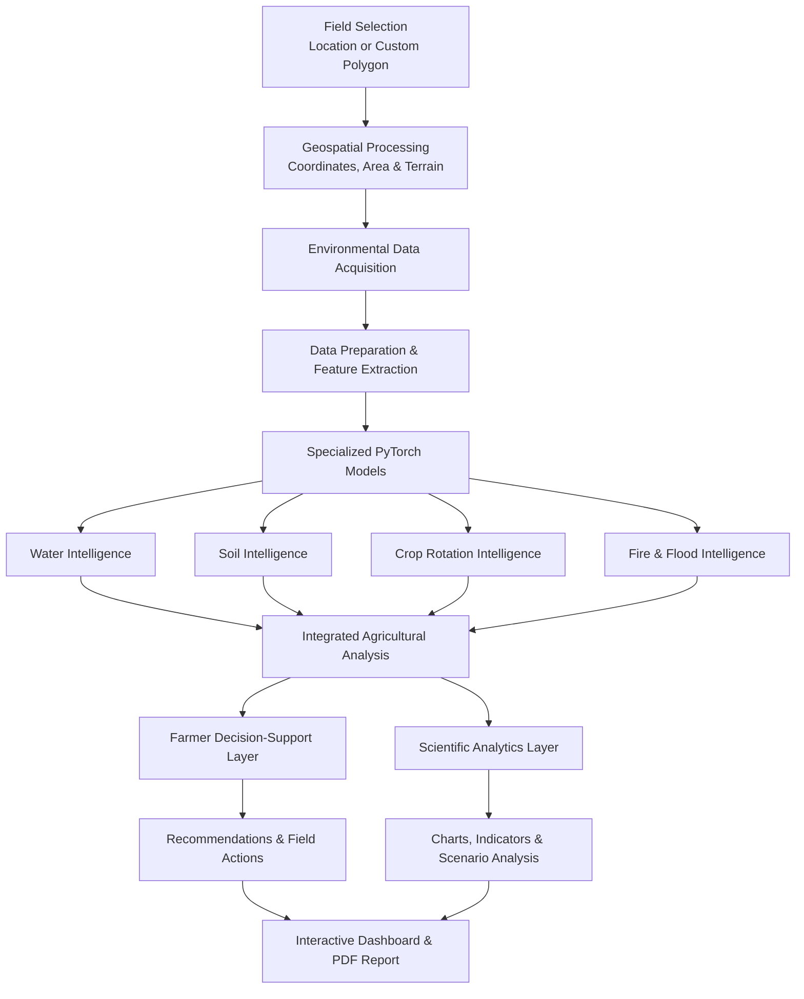

# TerraPulse — The GPS for Agriculture

**Observe the Earth. Understand the Soil. Cultivate the Future.**

> **Authors:** Gkekas Georgios, Kyritsis Thomas  
> **Project Paper:** *TerraPulse: A Precision Digital Agriculture Platform Leveraging NASA Earth Observation Data and Specialized Neural Networks* — [Read the Full Paper (PDF)](https://drive.google.com/file/d/1Itrr0SEqXuZhnRUyevfTjdnPLwHSKElD/view?usp=drive_link)

---

## Project Links & Media

- **Canva Presentation:** [View TerraPulse Pitch Deck](https://canva.link/r5jtxxe224ry0d1)
- **Project Presentation Video:** [Watch Project Presentation](https://drive.google.com/file/d/1H2_RAsfx15EeBXayk801OG2dDIiEk_Ui/view?usp=drive_link)
- **App Demonstration:** [Watch Live App Demonstration](https://drive.google.com/file/d/1H2_RAsfx15EeBXayk801OG2dDIiEk_Ui/view?usp=drive_link)
- **Technical Paper:** [Read the Scientific Paper (PDF)](https://drive.google.com/file/d/1Itrr0SEqXuZhnRUyevfTjdnPLwHSKElD/view?usp=drive_link)

---

## Overview

**TerraPulse** is an AI-powered precision agriculture and satellite intelligence platform designed to transform complex environmental data into practical, field-level decisions.

Agriculture is increasingly affected by water scarcity, soil degradation, unpredictable weather patterns, and extreme environmental events. Although Earth Observation satellites continuously collect valuable information about our planet, translating this information into decisions that farmers can actually use remains a significant challenge.

TerraPulse bridges this gap. By combining environmental datasets, meteorological information, geospatial analysis, and four specialized PyTorch neural networks, the platform turns complex land and climate information into accessible agricultural intelligence.

From identifying irrigation requirements and assessing soil conditions to recommending crop rotations and evaluating post-fire erosion risks, TerraPulse provides farmers with a unified environment for understanding their land and making more informed decisions.

**Our goal is simple: make advanced environmental intelligence accessible, understandable, and actionable at the scale of an individual field.**

---

## The Problem

Modern farmers face four interconnected challenges under a changing climate:

1. **Drought & Water Waste:** Irregular rainfall and heatwaves reduce root-zone soil moisture, while watering without telemetry wastes water and pumping electricity.
2. **Soil Exhaustion & Erosion:** Continuous monoculture drains organic matter, accelerates topsoil erosion, and drives up chemical fertilizer dependency.
3. **The Crop Rotation Dilemma:** Choosing the right next crop requires balancing soil history, aridity, nitrogen needs, and farm profitability.
4. **Wildfires & Extreme Storms:** After wildfires or severe weather, sloped farmland can lose its fertile topsoil in the very first heavy rain unless stabilized immediately.

These challenges are not independent. Excessive irrigation can increase operational costs, continuous cultivation can accelerate soil degradation, and poor crop rotation decisions can further reduce long-term soil fertility. Meanwhile, extreme weather events can intensify existing vulnerabilities and threaten agricultural productivity.

Addressing these problems requires more than isolated weather forecasts or generic agricultural recommendations. Farmers need a way to understand the condition of their land, interpret environmental changes, and evaluate the consequences of different management decisions.

**TerraPulse addresses all four challenges through one unified interface.** Users can select a geographical location or draw their exact field boundary on an interactive map. The platform then combines environmental telemetry, geospatial information, and specialized neural networks to explain what is happening in the field and what actions could be taken next.

---

## Our Solution

TerraPulse transforms a geographical location into a detailed agricultural intelligence profile.

Instead of presenting farmers with disconnected satellite measurements, weather forecasts, or complicated scientific indicators, the platform organizes environmental information into four interconnected analytical systems:

- **Water Intelligence:** Evaluates water stress and irrigation requirements using meteorological conditions, soil moisture, terrain, and evapotranspiration.
- **Soil Intelligence:** Assesses soil-related indicators, vegetation conditions, and erosion vulnerability to support more sustainable land management.
- **Crop Rotation Intelligence:** Evaluates alternative crops and nitrogen-related benefits to support soil recovery and long-term agricultural planning.
- **Extreme Event Intelligence:** Examines post-fire conditions and erosion vulnerability to support recovery and rapid intervention planning.

Each system combines a specialized PyTorch model with relevant environmental information to produce structured outputs and practical recommendations.

The platform presents its results through two complementary levels:

1. **Farmer-oriented intelligence:** Clear explanations, visual indicators, and actionable recommendations.
2. **Scientific analytics:** Detailed charts, model outputs, environmental variables, regional comparisons, and technical summaries.

This approach allows TerraPulse to serve both as a practical decision-support interface and as a scientific environment for exploring the relationship between environmental conditions and agricultural management.

---

## How TerraPulse Works

The platform follows a structured pipeline that connects geographical information with environmental datasets, model analysis, and agricultural recommendations.

### System Workflow



### Step-by-Step Process

**1. Field Selection and Geospatial Definition**

The user searches for a geographical location or draws a custom field polygon using the interactive map. TerraPulse processes the geographical coordinates and calculates the field's geodesic area in hectares and stremmata.

**2. Environmental Data Acquisition**

The platform retrieves relevant environmental information, including historical meteorological conditions, weather forecasts, soil moisture, elevation, and geographical data. Earth Observation datasets also provide scientific context and environmental baselines for the platform's analytical framework.

**3. Data Preparation and Feature Extraction**

Environmental variables are organized into structured inputs for the corresponding models. Depending on the analytical task, these include rainfall, temperature, soil moisture, vegetation indicators, terrain slope, aridity, evapotranspiration, and fire-related indicators.

**4. Specialized Neural Network Analysis**

Four independently developed PyTorch models process the relevant inputs. Each model focuses on a specific agricultural domain and produces outputs designed for its corresponding decision-support task.

**5. Integrated Agricultural Intelligence**

The outputs are translated into indicators, assessments, and recommendations. The platform combines model results with relevant environmental information to provide a more comprehensive understanding of field conditions.

**6. Decision Support and Scenario Simulation**

Farmers can explore alternative crops, irrigation methods, and environmental scenarios through the interactive simulator. Recommendations, charts, and analytical outputs update according to the selected conditions.

**7. Results and Reporting**

TerraPulse presents the results through an accessible dashboard, detailed scientific analytics, and a downloadable PDF agricultural report.

---

## Earth Observation & Environmental Datasets

Earth Observation provides an important scientific foundation for understanding agricultural land at different spatial and temporal scales. Satellite-derived measurements can reveal environmental patterns that are difficult to identify through conventional field observations alone.

TerraPulse draws on NASA Earth Observation missions and established environmental datasets to inform its scientific framework and the variables considered in its models.

### NASA Earth Observation Datasets

| Dataset / Mission | Environmental Contribution | Relevance to TerraPulse |
|---|---|---|
| **NASA POWER** | Meteorological and solar radiation parameters | Climate conditions, temperature, and agricultural water requirements |
| **SMAP** | Satellite-based soil moisture observations | Understanding soil water availability and drought conditions |
| **ECOSTRESS** | Land surface temperature and evapotranspiration-related observations | Assessing thermal stress and water-use conditions |
| **GPM** | Global precipitation measurements | Rainfall patterns, water availability, and extreme precipitation |
| **Landsat** | Multispectral land-surface observations | Vegetation characteristics and land-cover analysis |
| **MODIS** | Vegetation indices and environmental observations | Monitoring vegetation dynamics and broader environmental trends |
| **SRTM** | Digital elevation information | Terrain characteristics, slope, and erosion-related analysis |

These datasets contribute different types of environmental information. Their combined scientific value lies in connecting climate, vegetation, soil moisture, terrain, and land-surface conditions rather than treating each variable independently.

**Important implementation distinction:** The current operational data pipeline retrieves live meteorological, soil-moisture, elevation, and geographical information through Open-Meteo and OpenStreetMap services. NASA datasets are referenced as Earth Observation baselines and scientific inputs informing the project's modelling framework; they should not be interpreted as all being directly retrieved through live NASA API connections in the current application.

### Operational Live Data Sources

| Source | Data Retrieved | Application |
|---|---|---|
| **Open-Meteo Forecast & Historical API** | Historical temperature and rainfall, seven-day forecasts, FAO reference evapotranspiration (ET₀), and soil moisture | Water analysis and irrigation scheduling |
| **Open-Meteo Elevation API** | Elevation at the field center and four surrounding points | Terrain slope estimation |
| **OpenStreetMap Nominatim** | Worldwide geographical search | Location selection and field identification |
| **Esri World Imagery** | Satellite imagery basemap | Visual inspection of agricultural areas |
| **OpenTopoMap** | Topographic map information | Terrain visualization |

An in-memory cache and deterministic telemetry fallback help the application remain operational when external data services are temporarily unavailable.

---

## The Four Specialized PyTorch Models

TerraPulse uses four specialized neural networks, each developed for a distinct agricultural and environmental problem.

A major challenge in developing field-level models for these domains is the limited availability of large, consistently labelled datasets covering multiple years and geographical regions. For this reason, the models are implemented as **biophysically grounded surrogate models**, using agro-climatic inputs, domain-specific relationships, and scientifically informed parameterization.

The modelling framework draws on established concepts such as FAO-56 evapotranspiration, the Revised Universal Soil Loss Equation (RUSLE), biological nitrogen fixation (BNF), and post-fire burn-severity indicators such as dNBR.

### Network 1 — Water Intelligence

**Objective:** Evaluate agricultural water stress and support more efficient irrigation decisions.

The water model analyses environmental conditions that influence the availability and demand for water.

**Key inputs:**
- Six-month temperature history
- Rainfall history
- Soil moisture
- NDVI vegetation indicator
- Terrain slope
- Reference evapotranspiration (ET₀)

**Model outputs:**
- Root-zone water stress proxy (0–1)
- Estimated irrigation requirements in m³/stremma
- Suggested irrigation hours (05:00–07:00)
- Rain-aware irrigation scheduling

The irrigation schedule incorporates short-term weather forecasts and can skip a planned irrigation event when forecast rainfall reaches or exceeds 4 mm.

**Agricultural value:** Helps farmers understand when irrigation may be necessary and how environmental conditions influence water requirements, potentially reducing unnecessary water use and associated pumping costs.

### Network 2 — Soil Intelligence

**Objective:** Assess soil-related indicators and identify potential degradation and erosion risks.

Soil health is influenced by several interacting factors, including vegetation, organic matter, terrain, rainfall, and climatic conditions.

**Key inputs:**
- Spectral vegetation indicators
- Organic matter parameters
- Terrain slope
- Rainfall
- Aridity

**Model outputs:**
- `health_proxy` (0–1)
- `erosion_proxy` (0–1)
- Estimated NPK and carbon balance indicators
- No-till and cover-crop management recommendations

**Agricultural value:** Provides an integrated assessment of soil-related conditions and supports management strategies aimed at maintaining soil structure, limiting erosion, and reducing unnecessary dependence on external agricultural inputs.

The resulting indicators are model-derived proxies and should not be interpreted as direct laboratory measurements of soil composition.

### Network 3 — Crop Rotation Intelligence

**Objective:** Evaluate alternative crops and their potential contribution to long-term soil recovery.

Crop rotation is a central component of sustainable agricultural management. Selecting a suitable next crop requires considering the existing environmental conditions, soil characteristics, and potential benefits of different cultivation strategies.

**Key inputs:**
- Aridity
- Soil organic matter
- Terrain slope
- Soil moisture

**Model outputs:**
- Crop suitability scores for legumes, alfalfa, wheat, and sorghum
- Estimated biological nitrogen fixation (kg N/ha)
- Projected three-year nitrogen recovery
- Comparative economic and return-on-investment indicators

**Agricultural value:** Helps farmers explore crop diversification strategies and understand how nitrogen-fixing crops can contribute to soil fertility and reduce dependence on synthetic nitrogen fertilizers.

The model's recommendations are intended as decision-support estimates. Reliable real-world rotation planning also requires historical crop information, local crop calendars, and knowledge of crop-specific disease and management constraints.

### Network 4 — Fire & Flood Intelligence

**Objective:** Assess agricultural vulnerability following wildfires and extreme precipitation events.

Wildfires can remove vegetation cover and leave soil particularly vulnerable to erosion during subsequent rainfall. On sloped agricultural land, this can result in significant topsoil loss.

**Key inputs:**
- Burn severity indicators (dNBR)
- Terrain slope
- Vegetation condition
- Canopy heat indicators

**Model outputs:**
- Post-fire `erosion_risk` (0–1)
- `recovery_score` (0–1)
- Simulated twelve-month vegetation recovery
- A 72-hour rapid-seeding intervention plan
- Farmer SMS alert preview

**Agricultural value:** Supports the identification of vulnerable areas and provides a framework for prioritizing post-fire land recovery and erosion-control interventions.

The model's outputs are intended to support preliminary assessment and planning rather than replace field inspections or professional post-disaster assessments.

---

## Scientific Considerations & Model Interpretation

TerraPulse combines machine-learning architectures with environmental relationships derived from established scientific frameworks.

The purpose of this approach is to connect model outputs to meaningful agricultural variables rather than treating predictions as isolated numerical results.

Several scientific considerations are important when interpreting the platform's outputs:

- **Biophysical grounding:** The models are informed by established environmental and agricultural relationships, including FAO-56, RUSLE, BNF, and dNBR-based fire assessment.
- **Environmental variability:** Soil and climate conditions differ across geographical regions, meaning that recommendations must be interpreted in relation to local conditions.
- **Model-derived indicators:** Outputs such as soil health, erosion risk, and recovery scores are proxies generated by the analytical models, not direct measurements.
- **Data quality:** The reliability of any assessment depends on the quality, availability, spatial resolution, and temporal coverage of the underlying environmental inputs.
- **Scenario assumptions:** Simulated heatwaves, irrigation methods, and post-fire conditions represent modelled scenarios rather than guaranteed future outcomes.
- **Agricultural context:** Crop rotation and irrigation recommendations should account for field history, crop requirements, local agronomic practices, and other factors that may not be fully represented in the current implementation.

TerraPulse is designed as a decision-support platform. Its outputs should complement, rather than replace, field measurements, laboratory soil analysis, and professional agronomic judgement.

---

## Key Features

TerraPulse combines geospatial visualization, environmental analytics, machine learning, and interactive decision-support tools in one interface.

### Interactive 3D Earth Landing Page

A Three.js-powered 3D globe with orbital rings and a moving satellite marker introduces the platform. The interface includes Dark/Light themes and Greek/English language switching.

### Interactive Field Map OS

Built with Leaflet and Leaflet.Draw, the mapping environment allows users to:

- Switch between Dark OS, Satellite, and NDVI / Topographic base layers.
- Search for locations and agricultural regions worldwide using OpenStreetMap Nominatim.
- Draw custom field polygons and calculate geodesic area in hectares and stremmata.
- Visualize a 3×3 Variable Rate Application (VRA) sub-grid with nine colour-coded micro-zones and illustrative dose adjustments of +15%, 0%, and -15%.
- Save and compare two fields side-by-side, examining water stress, soil health, erosion risk, and estimated annual savings.

### Two-Layer Data Analysis Suite

**Layer 1 — At a Glance**

Designed for quick interpretation by farmers, this layer provides:
- An animated circular indicator.
- A plain-language headline and explanation.
- A numbered, step-by-step morning action plan.

**Layer 2 — Further Satellite Analytics**

Provides a more detailed analytical environment, including:
- Multi-series Chart.js graphs.
- Regional benchmarks.
- Annual cost breakdowns in euros.
- A live seven-day, rain-aware irrigation schedule.
- Interactive mini-maps.
- Detailed model outputs and scientific summaries.

### Interactive What-If Farmer Simulator

The simulator allows users to explore how changing agricultural and environmental conditions can influence the platform's outputs.

**Crop selection:**
- Durum Wheat
- Cotton
- Corn
- Olive Grove
- Vineyard
- Alfalfa

**Irrigation methods:**
- Flood Furrow — 52% efficiency
- Overhead Sprinkler — 74% efficiency
- Subsurface Drip — 93% efficiency

**Environmental scenarios:**
- Live Forecast
- Heatwave (+5.5°C)
- Post-Fire Storm

The selected scenario updates the relevant predictions, charts, and recommendations, allowing users to compare alternative management decisions.

### Voice Briefing

The integrated Web Speech API reads the active field advisory aloud in Greek (`el-GR`) or English (`en-US`).

### Bilingual Interface & Theme Support

The entire interface supports Greek and English, including navigation, charts, voice readouts, SMS previews, and scientific reports. Users can also switch between Dark and Light themes.

### PDF Agricultural Report

A dedicated print layout exports the field analysis into a clean, one-page PDF-style agricultural prescription sheet.

---

## Projected Ecological & Economic Impact

TerraPulse aims to support more efficient resource management, healthier agricultural soils, and improved resilience against environmental stress.

Its potential impact is connected to three main areas:

**1. Water Conservation**

Precision irrigation and weather-aware scheduling can reduce unnecessary irrigation events and improve the efficiency of agricultural water use.

**Literature benchmark:** Research on optimized irrigation scheduling reports potential water savings in the range of 27–45%, depending on crop, location, irrigation system, and management practices.

**2. Reduced Synthetic Nitrogen Dependency**

The integration of nitrogen-fixing legumes into crop rotation systems can contribute biologically available nitrogen and improve long-term soil management.

**Literature benchmark:** Biological nitrogen fixation can contribute approximately 32–115 kg N/ha/year under suitable crop and environmental conditions. Strategic use of legumes can reduce dependence on synthetic nitrogen inputs, with the actual benefit varying by cropping system and local conditions.

**3. Improved Agricultural Resilience**

By identifying potential erosion risks, evaluating soil-related indicators, and supporting post-fire recovery planning, TerraPulse aims to help farmers make more informed decisions under environmental stress.

**Important distinction:** These figures represent literature-derived benchmarks and potential benefits, not experimentally measured results or verified performance improvements achieved by TerraPulse itself.

---

## Literature & Scientific Foundations

The scientific framework of TerraPulse draws on established research and methodologies in agricultural water management, soil conservation, Earth Observation, and sustainable crop production.

| Scientific Framework | Application in TerraPulse |
|---|---|
| **FAO-56** | Reference evapotranspiration and crop water requirements |
| **RUSLE** | Soil erosion assessment and erosion-related indicators |
| **Biological Nitrogen Fixation (BNF)** | Estimation of nitrogen contributions from legumes |
| **dNBR** | Burn-severity assessment and post-fire environmental analysis |
| **NASA Earth Observation** | Environmental context from satellite-based observations of soil moisture, precipitation, vegetation, temperature, and terrain |

These frameworks provide the scientific context for the variables, relationships, and indicators used throughout the platform.

For detailed references, methodological explanations, and the scientific discussion, consult the accompanying [TerraPulse Technical Paper](https://drive.google.com/file/d/1Itrr0SEqXuZhnRUyevfTjdnPLwHSKElD/view?usp=drive_link).

---

## Scientific Methodology, Validation & Limitations

The development of TerraPulse follows a model-based approach that combines environmental data, scientific parameterization, neural-network processing, and interactive scenario analysis.

### Methodological Approach

1. **Environmental variable selection:** Identify relevant meteorological, soil-related, vegetation, and terrain variables for each analytical domain.
2. **Scientific parameterization:** Use established agricultural and environmental relationships to inform the model inputs and outputs.
3. **Model development:** Implement four specialized PyTorch networks, each targeting a different agricultural problem.
4. **Preprocessing:** Apply the corresponding normalization and preprocessing parameters required by the models.
5. **Inference:** Process field-level environmental inputs and generate structured model outputs.
6. **Decision-support translation:** Convert the resulting indicators into accessible explanations, visualizations, and recommendations.
7. **Scenario analysis:** Allow users to explore alternative crops, irrigation methods, and environmental conditions through the simulator.

### Validation Considerations

The scientific reliability of TerraPulse depends on further evaluation against independent reference data.

Important future validation activities include:

- Comparing water-stress estimates against field soil-moisture measurements.
- Evaluating soil-related indicators against laboratory soil analyses.
- Comparing erosion assessments with observed erosion data and established erosion models.
- Evaluating crop-rotation recommendations against local agronomic knowledge and historical field outcomes.
- Assessing post-fire recovery estimates against observed vegetation recovery and burn-severity information.
- Testing model performance across different geographical regions, seasons, and environmental conditions.

### Current Limitations

- Soil-health and erosion indicators are model-derived proxies, not direct laboratory or field measurements.
- Nitrogen fixation and nitrogen recovery estimates depend on assumptions about crop type, environmental conditions, and management practices.
- Economic and ROI estimates depend on input assumptions and local agricultural costs.
- Simulated scenarios do not guarantee that the same outcomes will occur under real-world conditions.
- Crop rotation recommendations would benefit from historical crop records, local crop calendars, and additional agronomic constraints.
- The current live data pipeline relies primarily on Open-Meteo and OpenStreetMap services; broader direct integration of NASA datasets remains an area for further development.

These limitations define the boundaries of the current implementation and provide a clear direction for future scientific validation.

---

## Future Development

TerraPulse is designed as an expandable agricultural intelligence platform. Several improvements could significantly increase its scientific depth, geographical coverage, and practical value.

**1. Expanded NASA Earth Observation Integration**

Develop direct integrations with relevant NASA Earth Observation services to retrieve and process satellite-derived datasets within the operational pipeline.

**2. Historical Field Intelligence**

Introduce persistent field histories, allowing farmers to track changes in vegetation, soil-related indicators, water stress, and crop rotation decisions across multiple seasons.

**3. Field-Based Scientific Validation**

Compare model outputs against real measurements, including laboratory soil analyses, field soil-moisture sensors, crop yields, and observed erosion.

**4. Advanced Crop Rotation Planning**

Extend the rotation model to incorporate crop history, local agricultural calendars, crop compatibility, disease constraints, and multi-year planning.

**5. Higher-Resolution Environmental Analysis**

Explore the integration of additional satellite observations and spatial datasets to improve field-level environmental characterization.

**6. Personalized Decision Support**

Allow farmers to define priorities such as water conservation, yield stability, input costs, and soil restoration, enabling recommendations to reflect different agricultural objectives.

**7. Long-Term Impact Monitoring**

Develop tools for tracking water use, nitrogen inputs, soil-related indicators, and estimated economic outcomes over successive agricultural seasons.

---

## Technical Architecture

TerraPulse follows a modular client-server architecture.

The frontend provides the interactive mapping environment, visualizations, scenario simulator, and reporting interface. The backend handles environmental data retrieval, model loading, inference, and the delivery of analytical results through REST API endpoints.

### System Components

**Frontend**
- HTML5 and modular JavaScript.
- Three.js for the interactive 3D Earth.
- Leaflet and Leaflet.Draw for geospatial visualization and field selection.
- Chart.js for analytical charts.
- API communication with the FastAPI backend.

**Backend**
- FastAPI application.
- Dedicated API routes for water, soil, crop rotation, and fire analysis.
- PyTorch model architectures and saved model weights.
- Environmental data retrieval and telemetry processing.
- Model preprocessing and inference.

### Repository Structure

```text
terra_pulse/
├── README.md
│
├── terra_pulse_frontend/
│   ├── index.html
│   ├── logo.png
│   ├── css/
│   │   └── styles.css
│   └── js/
│       ├── state.js
│       ├── globe.js
│       ├── charts.js
│       ├── map.js
│       ├── api.js
│       └── main.js
│
└── terra_pulse_backend/
    ├── main.py
    ├── requirements.txt
    │
    ├── core/
    │   ├── config.py
    │   ├── model_loader.py
    │   ├── geo_live.py
    │   └── telemetry.py
    │
    ├── routes/
    │   ├── water.py
    │   ├── soil.py
    │   ├── rotation.py
    │   └── fire.py
    │
    ├── training/
    │   ├── train_network1_water.py
    │   ├── train_network2_soil.py
    │   ├── train_network3_rotation.py
    │   └── train_network4_fire.py
    │
    └── *.pth / *.json
```

### Backend API Endpoints

| Endpoint | Function |
|---|---|
| `GET /api/water-analysis` | Water stress and irrigation analysis |
| `GET /api/soil-analysis` | Soil-related indicators and erosion assessment |
| `GET /api/rotation-analysis` | Crop suitability and nitrogen-related analysis |
| `GET /api/fire-analysis` | Fire-related erosion and recovery assessment |

---

## Quick Start Guide

### Requirements

- Python 3.10 or newer
- pip
- A modern web browser
- VS Code with Live Server (recommended)

### 1. Clone the Repository

```bash
git clone https://github.com/geogek10/Terra_Pulse_NGM_Team_NASA_Space_Apps_Challenge_2026.git
cd Terra_Pulse_NGM_Team_NASA_Space_Apps_Challenge_2026
```

### 2. Start the Backend

Navigate to the backend directory and install the dependencies:

```bash
cd terra_pulse_backend
pip install -r requirements.txt
```

Start the FastAPI server:

```bash
uvicorn main:app --reload
```

The backend will be available at:

```text
http://localhost:8000
```

Interactive API documentation:

```text
http://localhost:8000/docs
```

### 3. Start the Frontend

Open a second terminal and navigate to the frontend directory:

```bash
cd terra_pulse_frontend
```

Start a local development server:

```bash
python -m http.server 5500
```

Open the application in your browser:

```text
http://localhost:5500
```

Alternatively, use the VS Code Live Server extension to serve `index.html`.

### 4. Retrain the Neural Networks (Optional)

The model training scripts can be executed to regenerate the saved `.pth` weights and preprocessing `.json` files:

```bash
cd terra_pulse_backend

python training/train_network1_water.py
python training/train_network2_soil.py
python training/train_network3_rotation.py
python training/train_network4_fire.py
```

---

## Tech Stack

| Category | Technologies |
|---|---|
| **Frontend** | HTML5, CSS3, Tailwind CSS, Vanilla Modular JavaScript |
| **3D Visualization** | Three.js |
| **Geospatial Mapping** | Leaflet, Leaflet.Draw, OpenStreetMap |
| **Data Visualization** | Chart.js |
| **Backend** | Python, FastAPI, Uvicorn |
| **Machine Learning** | PyTorch |
| **Environmental Data** | Open-Meteo Forecast, Soil Moisture and Elevation APIs |
| **Geographical Data** | OpenStreetMap Nominatim |
| **Satellite & Terrain Visualization** | Esri World Imagery, OpenTopoMap |
| **Earth Observation Scientific Baselines** | NASA POWER, SMAP, ECOSTRESS, GPM, Landsat, MODIS, SRTM |
| **Browser Features** | Web Speech API, PDF/Print Export |

---

## The Vision

Agriculture is one of humanity's oldest industries, yet its future increasingly depends on our ability to understand a rapidly changing planet.

Satellites provide an unprecedented perspective on Earth's environmental systems. Scientific models help us interpret those observations. Artificial intelligence can connect complex environmental information with decisions that matter at the field level.

TerraPulse brings these elements together.

By translating environmental intelligence into practical agricultural guidance, we aim to help farmers move from reacting to environmental problems toward anticipating them, managing resources more efficiently, and cultivating more resilient agricultural systems.

**TerraPulse — Observe the Earth. Understand the Soil. Cultivate the Future.**
